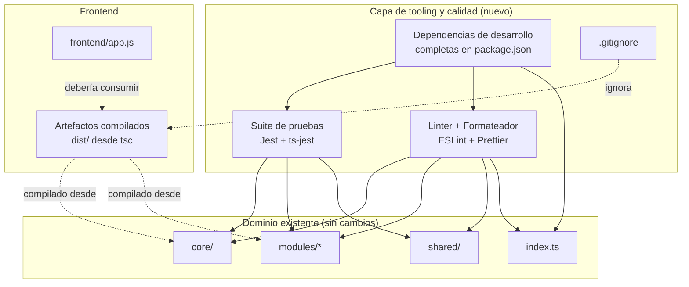
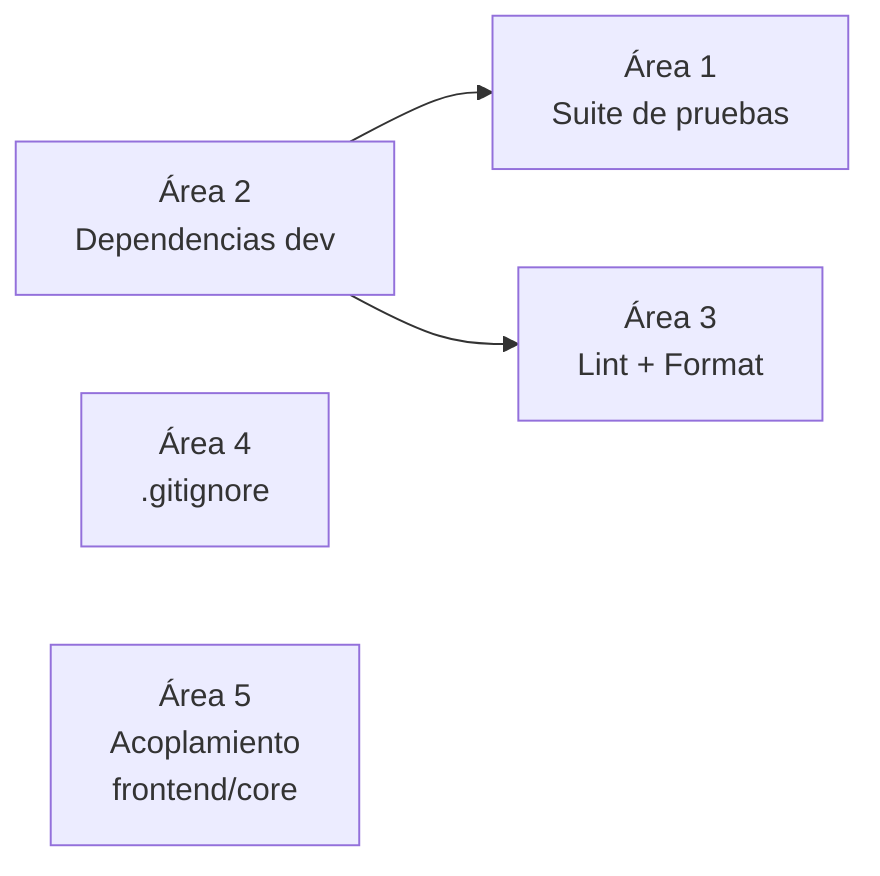

# Documento de Diseño: Mejoras de Estructura del Proyecto

## Overview

Cycora es una aplicación modular de seguimiento del ciclo menstrual escrita en TypeScript, con una arquitectura de dominio bien organizada (`core/`, `modules/profile|calendar|tracking|notifications/`, `shared/`). La arquitectura de dominio es sólida y **se preserva sin cambios**.

El objetivo de esta funcionalidad no es reescribir el dominio, sino **endurecer el tooling y la higiene del proyecto** para que el código sea más útil, verificable y mantenible. En una aplicación de salud, la lógica de cálculo de fases del ciclo y de la ventana fértil es crítica y hoy no está verificada por ninguna prueba automatizada: el `package.json` declara `"test": "jest"` pero ni Jest ni ts-jest están instalados y no existe ningún archivo de prueba. Además, faltan dependencias de desarrollo (`ts-node` es usado por el script `start` pero no está declarado), no hay linter ni formateador configurados, no hay `.gitignore`, y la carpeta `frontend/` (en JavaScript plano) reimplementa la lógica del dominio en lugar de reutilizar los módulos compilados de TypeScript.

Este diseño describe, a alto nivel, los componentes de tooling a introducir, cómo encajan con la estructura existente, los contratos (archivos de configuración y comandos) que exponen, y las propiedades de corrección esperadas. Se centra en diagramas, contratos de configuración y modelos de datos; no incluye algoritmos ni pseudocódigo.

## Architecture

La arquitectura de dominio permanece intacta. Las mejoras se añaden como una **capa de tooling y calidad** que rodea el código fuente existente sin acoplarse a su lógica interna.

Las cinco áreas de mejora se agrupan en componentes de tooling independientes entre sí, de modo que cada uno puede adoptarse por separado:

El Área 2 (dependencias) es prerrequisito de las Áreas 1 y 3, porque la suite de pruebas y el linter requieren paquetes declarados en `package.json`. Las demás áreas son independientes.

## Components and Interfaces

### Componente 1: Suite de Pruebas (Testing)

**Propósito**: Verificar de forma automatizada la lógica de cálculo crítica del dominio de salud, en particular el cálculo de fases del ciclo y de la ventana fértil, usando el framework que el proyecto ya declara (Jest con ts-jest para soportar TypeScript).

**Interfaz (contrato de configuración y comandos)**:

- Archivo de configuración de Jest en la raíz (por ejemplo `jest.config.js` o sección `jest` en `package.json`) que usa el preset de ts-jest y el entorno Node.
- Convención de ubicación de pruebas: archivos `*.test.ts` o `*.spec.ts` ubicados junto al código que prueban o en un directorio de pruebas espejo.
- Comando `npm test` que ejecuta la suite completa en modo de una sola corrida (sin watch).
- Cobertura mínima significativa de los servicios de cálculo: `CycleCalculatorService` (fases y predicción de ventana fértil), `DateUtils` (aritmética de fechas) y `HealthIndicatorsService` (indicadores clínicos).

**Responsabilidades**:
- Validar límites de fase (día menstrual, folicular, ovulatoria, lútea) sobre configuraciones biológicas por defecto y de borde.
- Validar que la ventana fértil se suprime correctamente bajo métodos anticonceptivos que inhiben la ovulación.
- Validar la aritmética de fechas ISO (desplazamiento de días, diferencia en días, detección de fecha pasada).
- No modificar la lógica de dominio; solo observarla a través de sus interfaces públicas.

### Componente 2: Gestión de Dependencias de Desarrollo

**Propósito**: Declarar en `package.json` todas las dependencias que los scripts y el tooling requieren, para que `npm install` deje un entorno reproducible y funcional.

**Interfaz (contrato de `package.json`)**:
- `devDependencies` completas: `ts-node` (usado por `start`), `jest`, `ts-jest`, `@types/jest`, y las dependencias de lint/format del Componente 3.
- Versiones fijadas o ancladas (sin rangos abiertos) para builds reproducibles.
- Scripts coherentes: `start`, `build`, `test`, y nuevos scripts de calidad (`lint`, `format`).

**Responsabilidades**:
- Garantizar que cada herramienta referenciada por un script esté declarada.
- Evitar dependencias huérfanas o no declaradas.

### Componente 3: Linter y Formateador

**Propósito**: Establecer un estándar de estilo y detección de errores estáticos consistente en todo el código TypeScript.

**Interfaz (contrato de configuración y comandos)**:
- Configuración de ESLint para TypeScript (por ejemplo `.eslintrc` con el parser y plugin de TypeScript) alineada con el `tsconfig.json` existente (modo estricto).
- Configuración de Prettier (por ejemplo `.prettierrc`) y archivos de exclusión (`.eslintignore` / `.prettierignore`) que excluyan `dist/` y `node_modules/`.
- Comandos `npm run lint` (verificación) y `npm run format` (formateo), ejecutables sin modo interactivo.

**Responsabilidades**:
- Analizar `core/`, `modules/`, `shared/` e `index.ts`.
- No introducir reglas que entren en conflicto con la configuración estricta del compilador.
- No reformatear ni analizar artefactos generados.

### Componente 4: Control de Versiones Higiénico (`.gitignore`)

**Propósito**: Evitar que artefactos generados y dependencias se incluyan en el control de versiones.

**Interfaz (contrato de archivo)**:
- Archivo `.gitignore` en la raíz que ignore al menos `node_modules/`, `dist/`, archivos de cobertura, logs y artefactos locales de editor/SO.

**Responsabilidades**:
- Mantener el repositorio limpio de archivos reproducibles.
- No ignorar código fuente ni configuración necesaria.

### Componente 5: Alineación Frontend ↔ Core

**Propósito**: Reducir la duplicación de lógica entre `frontend/app.js` (JavaScript plano) y el dominio TypeScript. Hoy el frontend reimplementa catálogos de métodos, estado y lógica en lugar de consumir los módulos compilados.

**Interfaz (contrato de integración)**:
- El dominio se compila a `dist/` mediante `npm run build` (configuración ya existente en `tsconfig.json`).
- El frontend debe consumir los artefactos compilados o tipos compartidos en lugar de redefinir reglas de negocio (por ejemplo, catálogo de métodos anticonceptivos, umbrales biológicos, cálculo de fases).
- Punto de integración documentado para que una única fuente de verdad (el dominio) alimente la capa de presentación.

**Responsabilidades**:
- Identificar la lógica duplicada entre `app.js` y los módulos de dominio.
- Proponer un punto de reutilización sin reescribir la UI completa.
- Preservar el comportamiento de onboarding y persistencia local existente del frontend.

**Nota**: Esta área es la de mayor alcance potencial. El diseño la trata como una mejora incremental y documentada, no como una reescritura del frontend.

## Data Models

Esta funcionalidad introduce principalmente **artefactos de configuración**, no entidades de dominio nuevas. Los modelos de datos relevantes son los contratos de los archivos de configuración y del manifiesto del proyecto.

### Modelo 1: Manifiesto del proyecto (`package.json`)

Contrato ampliado del manifiesto:

| Campo | Contenido esperado |
| :--- | :--- |
| `scripts.start` | Ejecuta la demo con `ts-node` |
| `scripts.build` | Compila con `tsc` a `dist/` |
| `scripts.test` | Ejecuta Jest en una sola corrida |
| `scripts.lint` | Ejecuta ESLint sobre el código fuente |
| `scripts.format` | Ejecuta Prettier sobre el código fuente |
| `devDependencies` | `typescript`, `ts-node`, `jest`, `ts-jest`, `@types/jest`, ESLint (+parser/plugin TS), Prettier |

**Reglas de validación**:
- Toda herramienta usada por un script debe estar en `devDependencies`.
- Las versiones deben estar ancladas (sin rangos abiertos tipo `*`).

### Modelo 2: Configuración de pruebas (Jest)

| Campo | Contenido esperado |
| :--- | :--- |
| preset | Preset de ts-jest para TypeScript |
| testEnvironment | `node` |
| patrón de pruebas | `*.test.ts` / `*.spec.ts` |
| (opcional) cobertura | Umbrales sobre los servicios de cálculo |

**Reglas de validación**:
- La configuración debe resolver TypeScript según el `tsconfig.json` existente (modo estricto).
- Las pruebas no deben requerir red ni estado externo (el dominio ya ofrece una base de datos en memoria).

### Modelo 3: Configuración de calidad (ESLint + Prettier)

| Archivo | Contenido esperado |
| :--- | :--- |
| `.eslintrc(.json/.js)` | Parser y plugin de TypeScript, reglas alineadas con modo estricto |
| `.prettierrc` | Preferencias de formato del equipo |
| `.eslintignore` / `.prettierignore` | Excluyen `dist/`, `node_modules/`, cobertura |

**Reglas de validación**:
- No deben analizarse ni formatearse artefactos generados.
- Las reglas no deben contradecir el compilador estricto.

### Modelo 4: Exclusiones de control de versiones (`.gitignore`)

| Categoría | Entradas esperadas |
| :--- | :--- |
| Dependencias | `node_modules/` |
| Artefactos de build | `dist/` |
| Cobertura y logs | directorios de cobertura, `*.log` |
| Local editor/SO | archivos temporales de IDE/SO |

**Reglas de validación**:
- No se ignora código fuente ni configuración necesaria para reproducir el entorno.

## Correctness Properties

Propiedades que el tooling introducido debe cumplir, expresadas como invariantes verificables:

### Property 1: Cobertura total de fases
Para todo día del ciclo `d` con `1 ≤ d ≤ longitudCiclo`, `determinePhaseForCycleDay(d)` devuelve exactamente una fase; no existen días sin fase ni días con fase ambigua.
**Validates: Requirements 1.1**

### Property 2: Reversibilidad de la aritmética de fechas
Para toda fecha ISO válida `f` y todo entero `n`, se cumple `diffInDays(f, addDays(f, n)) = n`.
**Validates: Requirements 1.2**

### Property 3: Supresión coherente de la ventana fértil
Si el método anticonceptivo inhibe la ovulación (`isOvulationSuppressed`), entonces la predicción del ciclo no expone ni `nextOvulationDate` ni `fertileWindow`, y ninguna fase se marca como fértil.
**Validates: Requirements 1.3**

### Property 4: Reproducibilidad del entorno
Tras un `npm install` limpio, cada script declarado (`start`, `build`, `test`, `lint`, `format`) se ejecuta sin dependencias faltantes.
**Validates: Requirements 2.1**

### Property 5: No contaminación del control de versiones
Ningún artefacto generado (`dist/`, cobertura) ni dependencia (`node_modules/`) queda bajo seguimiento de Git.
**Validates: Requirements 4.1**

### Property 6: No regresión del dominio
La introducción de tooling no modifica la lógica ni las interfaces públicas de `core/`, `modules/` ni `shared/`.
**Validates: Requirements 5.1**

## Error Handling

### Escenario 1: Dependencia faltante al ejecutar un script

**Condición**: Un script (`start`, `test`, `lint`) se ejecuta pero la herramienta no está instalada.
**Respuesta**: El fallo debe ser explícito y temprano; la mejora del Componente 2 elimina la causa al declarar todas las dependencias.
**Recuperación**: `npm install` deja el entorno completo y reproducible.

### Escenario 2: Prueba de cálculo falla

**Condición**: Un cambio futuro altera el cálculo de fase o de ventana fértil y rompe una prueba.
**Respuesta**: La suite falla en `npm test` señalando el servicio y caso afectados.
**Recuperación**: El fallo protege la lógica de salud crítica antes de integrar el cambio.

### Escenario 3: Conflicto entre linter y compilador

**Condición**: Una regla de ESLint contradice el modo estricto de TypeScript.
**Respuesta**: La configuración se alinea con `tsconfig.json` para evitar reglas contradictorias.
**Recuperación**: Ajustar la configuración del linter, no relajar el compilador.

### Escenario 4: Divergencia de lógica frontend/core

**Condición**: El frontend y el dominio implementan reglas de negocio distintas (por ejemplo, umbrales biológicos).
**Respuesta**: El Componente 5 documenta el punto único de verdad y la lógica duplicada detectada.
**Recuperación**: Reutilizar los artefactos compilados del dominio en la capa de presentación.

## Testing Strategy

### Enfoque de pruebas unitarias

Priorizar los servicios de cálculo que afectan decisiones de salud:
- `CycleCalculatorService`: límites de cada fase sobre el ciclo por defecto (28 días / periodo 5) y sobre ciclos de borde (mínimo 21, máximo 35), y correcta supresión de ovulación/ventana fértil bajo métodos que la inhiben.
- `DateUtils`: `addDays`, `diffInDays` e `isPastDate` sobre fechas ISO, incluyendo cruces de mes.
- `HealthIndicatorsService`: generación de indicadores clínicos esperados ante combinaciones de síntomas, flujo y método.

### Enfoque de pruebas basadas en propiedades

Aplicable a la aritmética de fechas y a la cobertura de fases:
- Toda la numeración de días del ciclo (de 1 a la longitud del ciclo) debe mapear a exactamente una fase.
- `diffInDays(a, addDays(a, n))` debe ser igual a `n` para enteros válidos.

**Biblioteca de pruebas basadas en propiedades**: fast-check (ecosistema JavaScript/TypeScript).

### Enfoque de pruebas de integración

Verificar que `npm run build` produce `dist/` y que `npm test`, `npm run lint` y `npm run format` se ejecutan sin intervención interactiva tras un `npm install` limpio.

## Dependencies

Dependencias de desarrollo a introducir o confirmar (externas, de tooling; no afectan el runtime del dominio):

- `typescript` (ya presente)
- `ts-node` (usado por `start`, a declarar)
- `jest`, `ts-jest`, `@types/jest` (suite de pruebas)
- ESLint con parser/plugin de TypeScript (análisis estático)
- Prettier (formateo)
- `fast-check` (opcional, para pruebas basadas en propiedades)

No se introducen dependencias de runtime nuevas en el dominio. La arquitectura modular existente se preserva en su totalidad.
